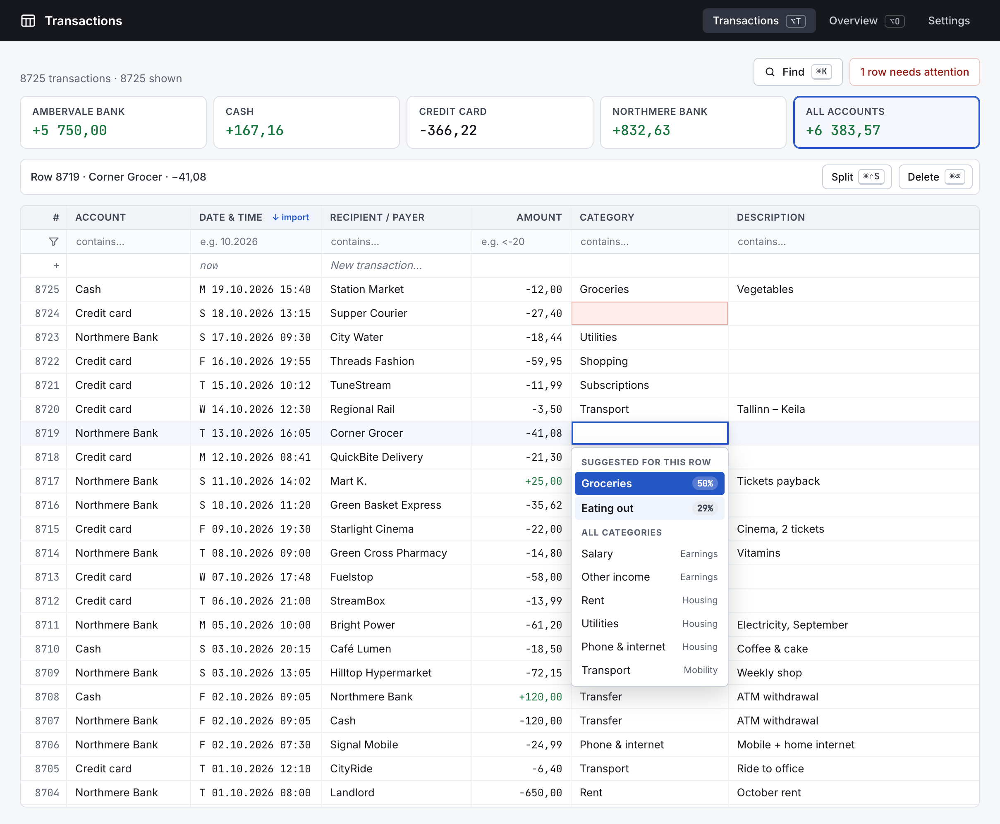
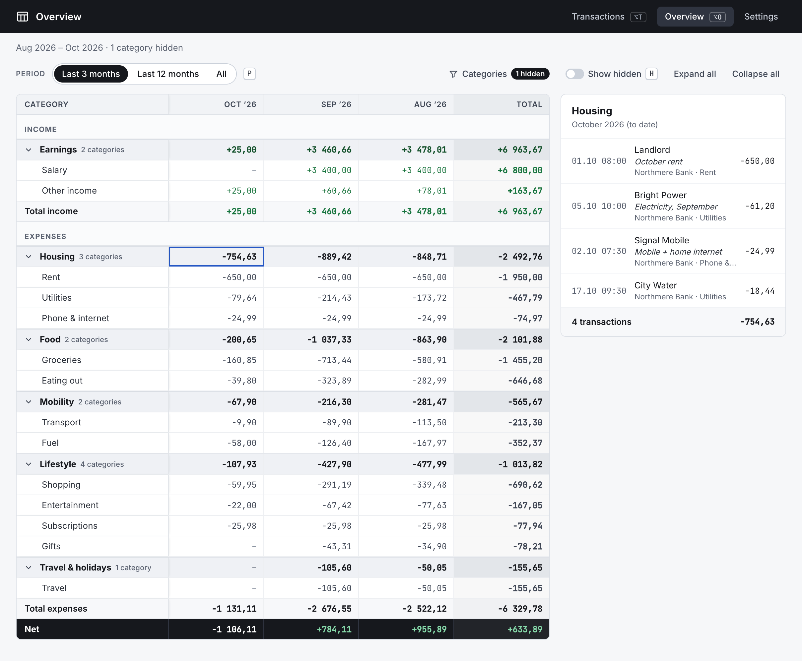

# Expense Tracker

Personal expense tracker. Node + SQLite, one Docker container.

<p>
  <a href="docs/screenshots/transactions.png"></a>
  <a href="docs/screenshots/overview.png"></a>
</p>

## Run with Docker

Needs Docker with Compose.

```sh
cp .env.example .env                                   # optional settings
cp compose.example.yaml compose.yaml                   # adjust port, volumes
mkdir -p data && cp seed.example.json data/seed.json   # optional, see below
docker compose build                                   # build the image
docker compose up -d                                   # start in the background
```

Open http://localhost:8080.

| | |
| --- | --- |
| Logs | `docker compose logs -f` |
| Stop | `docker compose down` (data stays in `data/`) |
| Update | `git pull && docker compose up -d --build` |

There is no authentication: anyone who can reach the port can use the app. Do not expose it to the internet.

The seed file is optional: without it the app starts empty, and categories are added in Settings. It is read only on the first start, when `data/expenses.db` does not exist yet; later it is ignored. To re-seed, delete the database (all data is lost).
Seed transactions use the import format below; `externalId` is optional, `category` is a name from the seed.

## Backup

```sh
docker compose exec app npm run backup -- --keep 30   # data/backups/
```

Restore: stop, copy a backup over `data/expenses.db`, delete `data/expenses.db-wal` and `-shm`, start.
Upgrades back up automatically first.

## Import

`POST /api/transactions/import`, 1–1000 rows:

```json
[
  {
    "externalId": "bank-transaction-123",
    "account": "The Account",
    "occurredAt": "2026-10-20T14:30:00+03:00",
    "counterparty": "The Store",
    "amount": -1250,
    "description": "optional"
  }
]
```

- `amount` in hundredths; `occurredAt` with zone.
- Any invalid row → nothing saved, `422` lists every issue.
- Known `externalId` → skipped (your edits stay). Re-import only after deleting every row with that id.
- Skipped with a different amount → also in `ignoredConflicts`: `externalId`, `savedAmount` (splits summed), `sentAmount`, and `saved`, the rows (`id`, `occurredAt`, `counterparty`, `amount`, `description`).

## Development

```sh
npm install
npm run dev         # :5173, API on :8787
npm run seed:demo   # 8,725 demo rows into an empty database
npm run build && npm start   # :8080 without Docker
npm test && npm run e2e
```

Schema changes: add the next `server/migrations/NNN_*.sql`; never edit a released one.

## License

[MIT](LICENSE)
